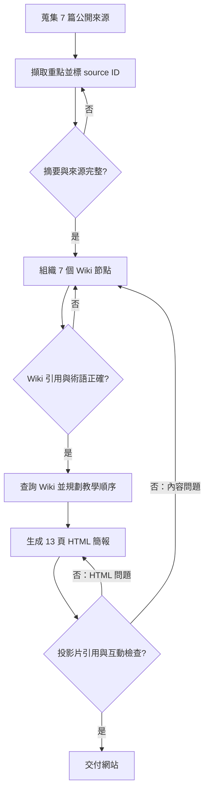

# Analog Circuit Design LLM Wiki — Workflow / Graph

## 0. 先討論、後生成
- 目標讀者：沒有類比 IC 背景的學生。
- 主題邊界：OTA、小訊號 gm/ro、two-stage、Gain/GBW/PM、Transistor Sizing、SPICE。
- 教學順序：概念 → 電路 → 性能指標 → 操作流程 → 測驗。
- 產出策略：來源摘要建立成 JSON Wiki，再由 Wiki ID 對應簡報。此版本是人工策展資料與規則式生成，沒有串接 LLM API、沒有向量資料庫。

## 1. 流程圖

## 2. Loop 設計
- Loop A：來源 URL、facts、summary 不完整時，重新整理來源；不要讓內容直接進入 Wiki。
- Loop B：每個 Wiki 節點必須具有至少一個存在的 source ID；沒有依據則先補查資料。
- Loop C：每張投影片必須至少引用一個存在的 Wiki ID。若有缺漏，重建映射；若術語或條件被過度簡化，回到 Wiki 補充再重建。

## 3. 實際檢查
執行 `python3 scripts/build.py && python3 scripts/validate.py`，產生 HTML 與規則式檢查紀錄 `docs/validation-report.txt`。
檢查內容包含來源數、ID 唯一、URL 格式、Wiki 引用、簡報對應、HTML 檔案等。
注意：這種檢查不是外部 URL 即時連線檢測，也不代表所有技術語義都已自動驗證。

## 4. 反思
- **最容易出錯：** Wiki 到投影片的引用映射；簡化 gm、GBW、PM 定義容易忽略條件。
- **檢查前移：** 在 HTML 生成前，針對每個 Wiki 節點的來源及適用條件進行核對。
- **修改 graph：** 原本單向的 pipeline，增加 source、wiki、slide 的回退分支；並在 Wiki 加入 pitfall 欄位。這樣可在錯誤複製到多張投影片前修正。

## 5. Slide to Wiki mapping
| Slide | Wiki IDs |
|---|---|
| 01 | W01 W03 W05 |
| 02 | W01 W02 W03 W04 W05 |
| 03 | W01 |
| 04 | W02 |
| 05 | W03 |
| 06 | W04 |
| 07 | W04 W03 |
| 08 | W05 |
| 09 | W06 |
| 10 | W05 W07 |
| 11 | W04 W05 W07 |
| 12 | W05 W07 |
| 13 | W01 W04 W05 W07 |
